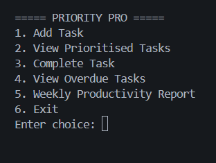

# CP-092 PriorityPro: Eisenhower Matrix Task Prioritisation Engine

## Team

Tauqeer Ahmed (1AT24CS237), Sunny Raj (1AT24CS222)

Java Track  
Domain: Productivity, Security and Developer Tools

## How to Run

1. Open the project folder in VS Code.
2. Open the terminal.
3. Compile and run the program:

```bash
javac Main.java
java Main
```

## Features That Work

1. Add tasks with title, due date, importance and estimated effort in hours.
2. Classify tasks into four Eisenhower Matrix quadrants:
   - Q1: Do First
   - Q2: Schedule
   - Q3: Delegate
   - Q4: Do Later
3. Display tasks in priority order, using due date as the secondary sorting condition.
4. Mark tasks as completed.
5. View overdue tasks that are still pending.
6. Generate a weekly productivity report showing:
   - Total completed tasks.
   - Tasks completed on time.
   - Tasks completed late.
   - On-time completion percentage.

## Sample Run

### Main Menu


