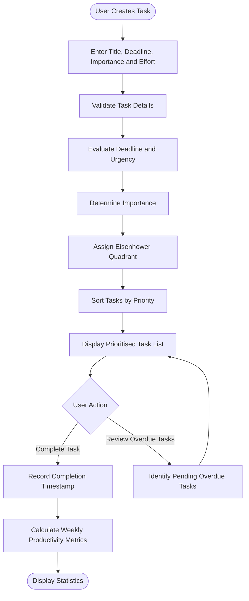
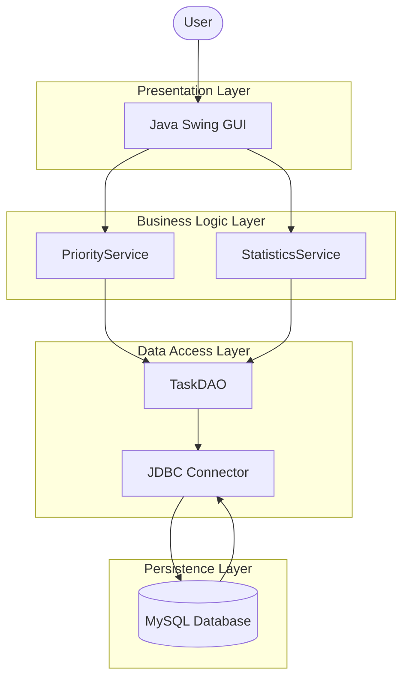

# ⚡ PriorityPro
### Eisenhower-Matrix Task Prioritisation Engine

<p align="center">
  <strong>Prioritise smarter. Work with purpose. Measure your progress.</strong>
</p>

<p align="center">
  
  
  
</p>

---

## 📌 Overview

**PriorityPro** is a task prioritisation and productivity management application designed to help students and professionals decide what deserves their attention first.

Traditional to-do lists store tasks, but they do not always help users distinguish between urgent deadlines, important long-term goals and low-priority activities.

PriorityPro addresses this challenge using the **Eisenhower Matrix**, automatically classifying tasks based on urgency and importance. It combines priority-based sorting, deadline tracking, task completion monitoring and weekly productivity analytics in one system.

> **The goal is simple:** Spend less time deciding what to do and more time doing what matters.

## 🎯 Problem Statement

Students and professionals frequently manage multiple responsibilities with competing deadlines and varying levels of importance. Without a structured prioritisation method, they may focus on less valuable activities, postpone important work and miss deadlines.

Existing basic task lists primarily organise tasks without necessarily providing a systematic method to evaluate urgency, importance and productivity.

PriorityPro aims to solve this problem by transforming an ordinary task list into a structured prioritisation engine that helps users organise responsibilities, identify overdue work and evaluate their completion performance.

## ✨ Key Features

| Feature | Description |
|---|---|
| 📝 Task Management | Create tasks with a title, due date, importance and estimated effort. |
| 🧠 Smart Classification | Automatically classify tasks into four Eisenhower Matrix quadrants. |
| 📊 Priority Ranking | Sort tasks using quadrant priority, overdue status and due dates. |
| ✅ Completion Tracking | Mark tasks as completed and record completion timestamps. |
| ⏰ Overdue Detection | Identify pending tasks whose deadlines have passed. |
| 📈 Productivity Analytics | Track weekly completed tasks and on-time completion percentage. |
| 🔄 Recurring Tasks *(Optional)* | Support repeated tasks on configurable schedules. |
| 🗓️ Daily Planning *(Optional)* | Recommend tasks that fit within the user's available time. |

## 🧩 The Eisenhower Matrix

PriorityPro uses four quadrants to categorise tasks and recommend the appropriate action.

| Quadrant | Urgency | Importance | Recommended Action |
|:---:|---|---|---|
| 🔴 Q1 | Urgent | Important | **DO FIRST** |
| 🔵 Q2 | Not urgent | Important | **SCHEDULE** |
| 🟠 Q3 | Urgent | Not important | **HANDLE OR DELEGATE** |
| ⚪ Q4 | Not urgent | Not important | **DO LATER OR ELIMINATE** |

**Classification logic**

- **Urgency:** Determined by comparing the task's deadline with the current date and time.
- **Importance:** Selected by the user when creating the task.
- **Quadrant:** Calculated from the combination of urgency and importance.

For the initial implementation, a configurable 24-hour threshold can define urgency. Overdue tasks are flagged separately so that expired deadlines receive appropriate attention.

## ⚙️ How It Works



### Workflow Explanation

**01 — Create a task**

The user enters the task title, deadline, importance level and estimated effort.

**02 — Evaluate urgency**

The application compares the deadline against the current time to determine whether the task is urgent or overdue.

**03 — Classify the task**

The priority service assigns the task to Q1, Q2, Q3 or Q4 using the urgency and importance rules.

**04 — Rank tasks**

Tasks are sorted by priority, with overdue status, quadrant, deadline and estimated effort used as ranking criteria.

**05 — Track completion**

When a task is completed, its status and completion timestamp are updated.

**06 — Measure productivity**

The statistics service calculates weekly completion counts and the percentage of eligible completed tasks finished on time.

## 🏗️ System Architecture

PriorityPro follows a **layered software architecture** that separates the user interface, business logic, database operations and persistent storage.



### Architecture Components

| Component | Responsibility |
|---|---|
| **Presentation Layer** | Provides the graphical interface for task creation, prioritisation and analytics. |
| **PriorityService** | Evaluates urgency, assigns quadrants and sorts tasks. |
| **StatisticsService** | Calculates weekly completion metrics and overdue information. |
| **TaskDAO** | Handles database queries, inserts and task updates. |
| **JDBC** | Connects Java application code to the database. |
| **MySQL** | Stores task records and completion history persistently. |

This separation makes the application easier to test, maintain and extend.

## 🛠️ Technology Stack

The following is the proposed implementation stack.

| Technology | Purpose |
|---|---|
| **Java 17** | Core application logic and object-oriented programming |
| **Java Swing** | Desktop graphical user interface |
| **JDBC** | Communication between Java and the database |
| **MySQL** | Persistent relational data storage |
| **MySQL Connector/J** | JDBC driver for MySQL |
| **Git** | Source-code version control |
| **GitHub** | Repository hosting and project documentation |
| **VS Code** | Development and debugging environment |

*Only retain technologies that are actually used in the final implementation.*

## 🗄️ Database Design

The initial version uses a relational table named `tasks`.

| Field | Description |
|---|---|
| `task_id` | Unique identifier for each task |
| `title` | Task name or description |
| `due_date` | Task deadline |
| `importance` | User-defined importance level |
| `effort_hours` | Estimated time required |
| `status` | Pending or completed |
| `created_at` | Task creation timestamp |
| `completed_at` | Task completion timestamp |

The task's quadrant is calculated dynamically rather than permanently stored. This allows the application to reclassify a task as its deadline approaches.

## 🧠 Algorithms and Core Concepts

PriorityPro demonstrates practical software engineering and algorithmic concepts.

- **Rule-based classification:** Uses conditional logic to map urgency and importance to four quadrants.
- **Multi-criteria sorting:** Ranks tasks by several criteria using a comparator.
- **Date-time processing:** Evaluates deadlines, urgency thresholds and overdue status.
- **CRUD operations:** Creates, retrieves and updates task records in the database.
- **Productivity calculations:** Aggregates completed tasks and evaluates on-time performance.

**Sorting complexity:** For \(n\) tasks, comparison-based sorting generally takes \(O(n\log n)\) time.

## 📈 Productivity Metrics

PriorityPro tracks completion performance using task timestamps.

### On-Time Completion Percentage

\[
\text{On-Time \%} =
\frac{\text{Tasks Completed On Time}}
{\text{Completed Tasks with Valid Deadlines}}
\times 100
\]

Tasks completed on or before their deadlines are counted as on-time completions.

The weekly dashboard can include:

- Tasks completed during the current week.
- Tasks completed on time.
- Tasks completed late.
- Pending overdue tasks.
- Overall on-time completion percentage.

The reporting period and calculation denominator should be defined consistently. When there are no eligible completed tasks, the percentage should be displayed as unavailable rather than implying a meaningful performance result.

## 🚀 Getting Started

### Prerequisites

Install the following before running the application:

- Java Development Kit (JDK) 17 or later.
- MySQL Server.
- MySQL Connector/J.
- Git.
- A Java-compatible IDE, such as VS Code.

### Installation

**1. Clone the repository**

```bash
git clone https://github.com/YOUR_USERNAME/PriorityPro.git
cd PriorityPro
```

**2. Create the database**

```sql
CREATE DATABASE prioritypro;
```

**3. Configure database connectivity**

Set the database URL, username and password in your application's database configuration. Avoid committing credentials to GitHub.

**4. Configure the JDBC driver**

Add MySQL Connector/J to the project's dependencies or classpath.

**5. Build and run**

Open the project in your Java IDE, resolve the dependencies, and run the application's main class.

> The exact build commands and database schema should be added after confirming the repository's actual project structure.

## 🔮 Future Enhancements

- 🔔 Desktop notifications for approaching deadlines.
- 🔁 Recurring tasks and scheduled repetitions.
- 🗓️ Time-budget-based daily planning.
- 📊 Charts showing weekly and monthly productivity trends.
- 🔎 Search, filtering and task editing.
- 👤 User authentication and individual task management.
- 📅 Calendar integration.
- 🧮 Advanced scheduling that considers task dependencies, available hours and priorities.

## 🎓 Learning Outcomes

This project provides practical experience with:

- Object-oriented programming in Java.
- Data validation and business-rule design.
- Sorting algorithms and comparators.
- Date and time handling.
- Relational database design and SQL.
- JDBC integration.
- Layered software architecture.
- Productivity metrics and edge-case testing.

## 🤝 Contributing

Contributions and suggestions are welcome.

1. Fork the repository.
2. Create a feature branch.
3. Implement and test your changes.
4. Submit a pull request describing the changes.

## 📄 License

Choose an appropriate open-source license before publishing the project. For example, the MIT License may be suitable if you want others to use, modify and distribute the code under its terms.

---

<p align="center">
  <strong>PriorityPro — Make priorities clear. Make progress measurable.</strong>
</p>
